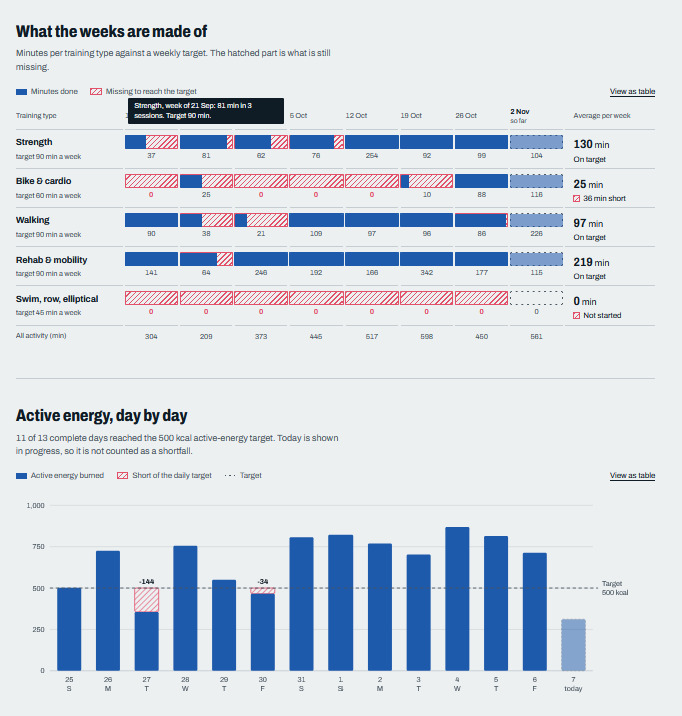

# Hyper-personalized training dashboard

A small local dashboard that reads my Garmin data, shows what my training weeks are really made of, and, only when I press a button, asks an LLM for training and nutrition advice. Every suggestion is checked by plain code against my knee-injury rules before I see it.



## Why I built it

I consider myself an active person. I train, I see a physio for recovery, and I assumed I was doing things right. I wanted a second opinion based on data, not on feelings.

The idea: connect Garmin to an LLM through **MCP**, ask natural-language questions about my training, and cross the answers with context the model would not otherwise have (a blood test and my injury history). This repo is the dashboard that came out of that.

Goals: lose fat and build muscle, with knee injuries (no impact, no loaded leg work, only shallow unloaded squats).

## How it fits together

- **MCP server.** I used [Taxuspt/garmin_mcp](https://github.com/Taxuspt/garmin_mcp), which exposes Garmin Connect to any MCP client (Claude, OpenCode, ...). That is how I asked questions in natural language.
- **This dashboard.** It is independent of the MCP server. It uses the same library ([`python-garminconnect`](https://github.com/cyberjunky/python-garminconnect)) and the same login tokens in `~/.garminconnect`, so authenticating once with `garmin-mcp-auth` covers both.
- **LLM advice.** DeepSeek (`deepseek-chat`), called **only** when you press *Refresh advice*. Opening the page never calls the model. The result is cached in `data/advice.json`.
- **Safety net.** The LLM suggests, code vetoes. Items that mention impact work, loaded leg work or deep squats are dropped, however they are phrased, and the number of removed items is stored.

## What it shows

- **Training mix.** Minutes per training type, per week, against a target. The hatched part is what is missing.
- **Active energy.** Daily active kcal against a daily target, with the shortfall drawn on top. Today is shown as in progress, never as a shortfall.
- **Profile table** with fixed values (age, height, weight) and values derived from Garmin.
- **Advice** in English, generated on demand.

## Blood test as context (optional, stays local)

If you put a lab-results CSV named `analitica*.csv` in `data/`, only the markers that are out of range are sent to the LLM, as context for the nutrition advice. Values are never shown on the page, and the model is told not to diagnose. The `data/` folder and every `.env` file are git-ignored, so none of this is ever committed.

## Requirements

- Python 3.12+ and [`uv`](https://docs.astral.sh/uv/).
- Garmin tokens in `~/.garminconnect` (or `$GARMINTOKENS`). If you do not have them, authenticate with `garmin-mcp-auth` from the MCP server above.
- A DeepSeek API key (only needed for the advice button).

## Setup and run

```bash
cp .env.example .env   # then set DEEPSEEK_API_KEY
uv run python -m fitdash
```

Open <http://localhost:8765>. It binds to `127.0.0.1` only. Fonts load from Google Fonts, so the page needs an internet connection.

## What is fixed, and where to change it

Everything below is in `src/fitdash/profile.py`. These are editable assumptions, not medical prescriptions. **Change them to match you before using the dashboard.**

- Profile values (age, height, weight).
- Weekly targets per training type and the daily active-energy target.
- The knee rules: forbidden and allowed exercises.

## Tests

```bash
uv run pytest
```

## Limitations

- Meals and sleep are not logged, so nutrition advice is orientative.
- The advice is general guidance only. It does not replace a physio or a doctor.
- Layout tested on desktop; mobile is not verified.
